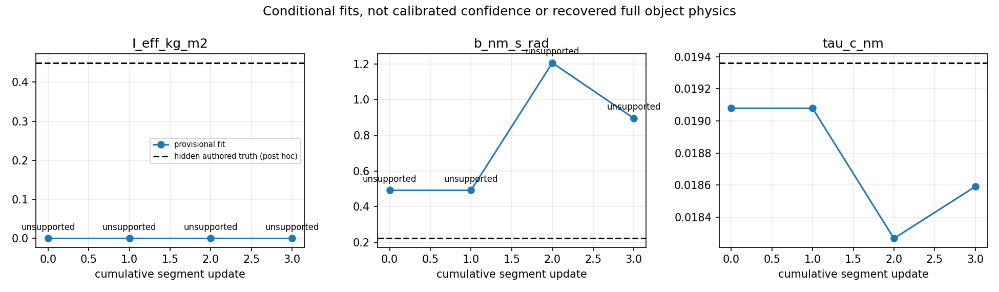
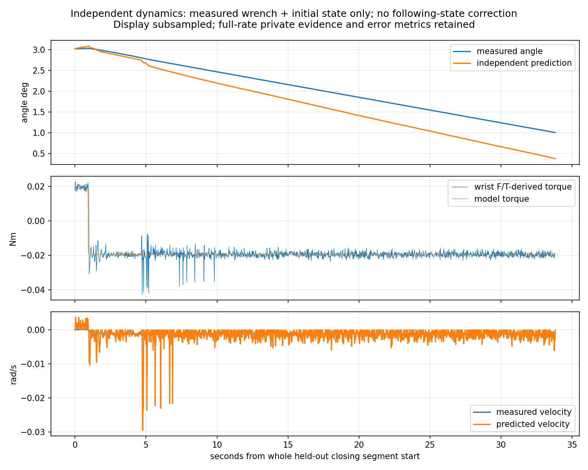
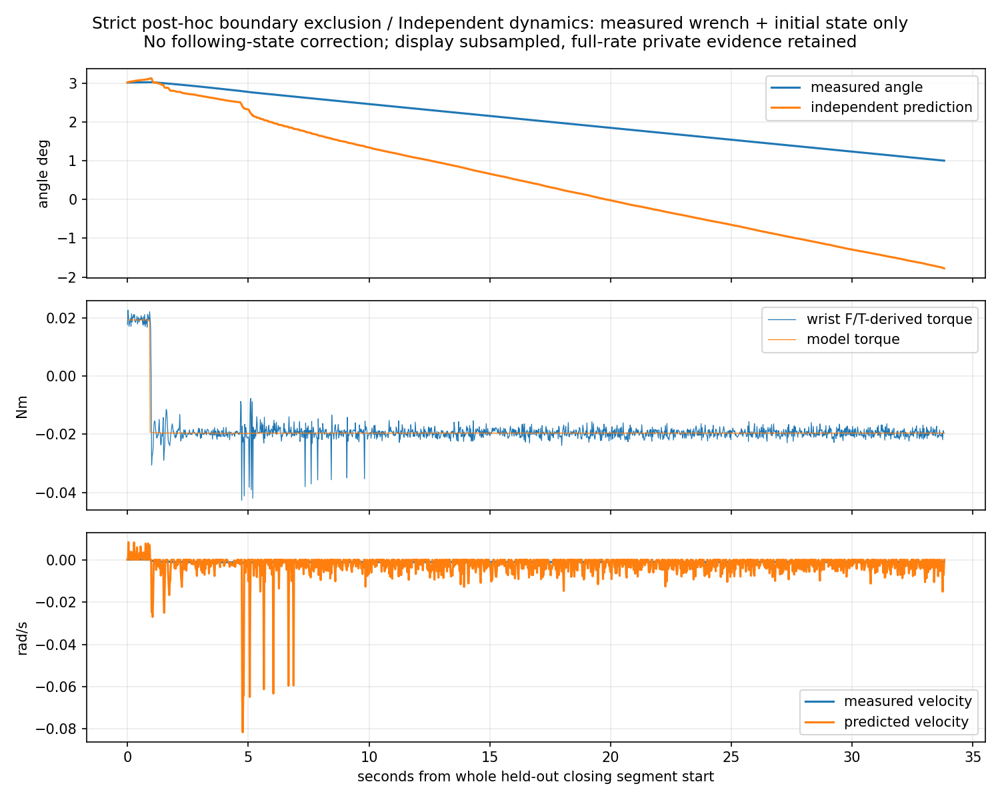

# Interaction-based physical identification V0 — xArm7 / native G1

**Result: partial capability demonstrated, not a validated dynamic physical twin.** A native six-axis fixed-interface sensor passed commissioning. All three seeded configurations were attempted; case 02 completed real opening/closing in one grasp and parked safely. Wrist-derived effort supports an effective Coulomb term. Inertia and viscous damping remain unsupported, and independent motion prediction is not reliable.

Reference: `136b6e0` Recovery V1.1. [All 44 frozen baseline files are byte-identical](FINAL_BASELINE_INTEGRITY.json). This separately versioned experiment retains known hinge geometry and actual object state, registered station, simulated wrist camera, native scene safety collisions and approximate actuators. Initial grasps use fresh wrist RGB-D; hidden dynamics never supply grasp poses or estimator inputs.

## What physically ran

One no-object sensor commissioning scene; one preserved precontact infrastructure-invalid scene (zero grasps); then exactly three registered normally closed identification scenes, sequentially. No additional contact trial or replacement configuration. No object drive, attachment, external door force, state restoration or stitching.

| Case / seed | Actual maximum | Actual contact interaction | Grasps / recovery | Final lifecycle | Sim s | Wall s including export |
|---|---:|---|---:|---|---:|---:|
| 00 / 17046427 | 3.04455° | First grasp +3.04277°; no closing | 2 / 1 | First safe park passed; recovery collision, SAFE_EXIT_UNAVAILABLE | 838.521 | 6,532.593 |
| 01 / 17046428 | 3.04416° | First grasp +3.04146°; no closing | 2 / 1 | First safe park passed; recovery collision, SAFE_EXIT_UNAVAILABLE | 831.629 | 6,116.088 |
| 02 / 17046429 | 6.05729° | 0 → 3.00401 → 1.00378 → 6.00403 → 2.00371° | 1 / 0 | Released, clearance reached, collision-checked native-rest park | 694.683 | 4,820.813 |

Case 02 used one continuous physical scene and one grasp, with the original hold and guards. The complete first closing segment, `VALIDATION_CLOSE_1`, was withheld from fitting. It lasted 33.817 s / 8,117 native samples. Final parked door angle was 2.006927°, pad loads 0/0 N. No force-protection event occurred in its interaction segments. Single-pad positive-normal reports intermittently disappeared while the door still moved; this did not become a new veto. Relative TCP/body translation proxy grew to approximately 0.93 mm, not a direct tactile slip measurement.

Cases 00/01 are retained failures of the full identification workflow. **The Agent/operator missed the existing 120 wall-second loaded decision deadline twice.** Late commands were not executed. Each first physical grasp had already opened approximately 3° and then safely parked. The sole permitted recovery used fresh observations and an automatically selected alternative; both hit the existing right-finger `gripper_link2` / non-handle `original38` collision stop before acquisition. Release-sweep checks rejected the same collision. No override or extra attempt followed.

After inspecting those measured F/T, wrist and contact results, a finite four-segment program was registered before case 02 outcomes: open to +3° at scale 0.6, close to +1° at 0.6 (held out), open to +6° at 1.0, close to +2° at 0.7, stop. Original realtime protections remained authoritative. **This is feedback-selected bounded execution, not demonstrated realtime per-segment Agent steering.** No hidden dynamics were consulted to choose it. The program was also queued for case 01's remaining recovery, which never acquired contact.

## Sensor: native transmitted wrench, with explicit mechanical limitations

The copied official robot description retains the original `link_eef` → `xarm_gripper_base_link` fixed interface, renamed `wrist_ft_interface`. Native `SingleArticulation.get_measured_joint_forces()` supplies incoming-joint spatial reaction, local child frame `[Fx,Fy,Fz,Tx,Ty,Tz]`, N / N·m. Runtime metadata joint index 7 maps to incoming row 8. It is **not** motor projected effort, object GT torque or summed normal contacts. The actual installed API/source was verified on Isaac `6.0.1-rc.7+release.42383.32955d8d.gl`.

The pinned description lacked exact sensor CAD/stack geometry. V0 therefore uses an **idealized zero-thickness, infinite-stiffness virtual load cell at the existing flange/tool interface**. Tool/TCP/camera transforms, downstream masses, G1 articulation, collisions and controllers remain unchanged. It does not model the actual sensor/adapter mass or thickness, hardware noise, saturation, bandwidth or precision. [Sensor definition and calibration mapping](SENSOR_CHANNEL_DEFINITION.json), [design](SENSOR_DESIGN.md).

Manufacturer references: [accessory introduction](https://docs.accessories.ufactory.cc/6_Axis_Force_Torque_Sensor/1.Introduction.html), [technical specifications](https://docs.accessories.ufactory.cc/6_Axis_Force_Torque_Sensor/5.Technical_Specifications.html), [raw/compensated SDK interface](https://docs.api.ufactory.cc/xarm_python_sdk_docs/7.-Force-Torque-Sensor.html), [Isaac articulation-force semantics](https://docs.isaacsim.omniverse.nvidia.com/latest/sensors/isaacsim_sensors_physics_articulation_force.html). Manufacturer 400 N / 20 N·m range, 0.4 N / 0.01 N·m resolution, 200 Hz and approximately 600 g including adapter are reference specifications, **not reproduced simulator accuracy**. Native physics remains 240 Hz.

Commissioning recorded 47,571 valid samples, 198.2125 sim s / 734.7785 wall s: several static wrist orientations; independent 1 N loads on three world axes at a known offset; three 0.05 N·m pure moments; smooth unloaded motion; tool gravity approximately 7.3715 N. Known-load residual RMS was at most approximately 7.2e-5 N and 1.5e-5 N·m. These verify numerical signs/transforms, not real sensor precision.

Raw sensor-frame and compensated world-frame six-axis traces remain separate and full-rate privately. Parent-on-tool raw reaction is converted to robot-on-object wrench at the sensor origin:

`W_contact = rotate(W_raw − bias) + W_tool_gravity − W_tool_inertia`

`tau_hinge = axis · [M_contact + (p_sensor − p_hinge) × F_contact]`

The prismatic projection is `axis · F_contact`. Each downstream body contributes official URDF mass/COM/inertia and measured body acceleration; no contact tare, orientation-independent gravity offset or double compensation. SG121 centered derivatives imply approximately 0.25 s latency. Independent isolated motor-drive force is unavailable; explicit effort commands and projected joint reactions are not relabeled as motor output.

**Unresolved dynamic sensor residual:** maximum unloaded motion-phase RMS approximately 0.01209 N / 0.003625 N·m at the sensor origin. Projecting onto the allowed hinge line gives phase RMS up to 0.004644 N·m, maximum sample 0.018371 N·m. Longer smoothing did not establish the cause. Conditional fit uncertainty is not calibrated confidence, especially at these small generalized torques. Full Cartesian forces can be substantially larger than the small hinge effort after moment-arm cancellation.

## Seeded physics and information boundary

Each fixed configuration perturbs both baseline 1 kg moving bodies with one mass scale and a positive affine-density box model. 7³ voxel quadrature plus voxel inertia generates coherent COM and positive full inertia; mass/inertia are not independently drawn. This follows the baseline geometry-box approximation, not CAD material identification. Priors were fixed before results: mass scale 0.75–1.25; each density-gradient coordinate −0.30…0.30; Coulomb 0.015–0.045 N·m; viscous 0.10–0.35 N·m·s/rad; no spring.

| Case | Each moving-body mass kg | Authored I_eff kg·m² | Authored b N·m·s/rad | Authored τc N·m |
|---|---:|---:|---:|---:|
| 00 | 1.116898 | 0.490131 | 0.102506 | 0.0442041 |
| 01 | 0.790062 | 0.280777 | 0.333710 | 0.0365307 |
| 02 | 1.143162 | 0.449436 | 0.221351 | 0.0193622 |

Native `PhysxJointAxisAPI:angular` static/dynamic friction and viscous coefficients are authored before `World.reset`, with static=dynamic Coulomb. Installed schema uses torque·seconds/**degree** for angular viscous coefficients: authoring converts `b_rad*pi/180`. Old load-dependent resistance and object drive are zero. This establishes authored native parameters and their schema; effective solver/contact dynamics are not assumed identical to the ideal one-joint equation. An independently recorded complete GT generalized-effort channel is unavailable; post-hoc authored inverse dynamics is explicitly a reference, not a measured GT torque channel.

[Truth-access boundary](POST_EPISODE_TRUTH_ACCESS.json): all three actors were gone and exports complete at 2026-10-16 22:21:52 UTC before independent evaluation opened truth. Estimation receives only robot-side measurements, tool calibration and an explicit allowed kinematic prior. No true mass, COM, inertia or resistance enters fitting/actions.

## Identification, uncertainty and held-out prediction

Frozen nonnegative constant model: `tau = I_eff*qdd + b*qd + tau_c*sign(qd)`. Native data retained; fit uses non-overlapping 0.1 s bins, fixed scaling/regularization and conditional covariance floor 0.0037 N·m. Transients, motion derivatives, slip proxies and original force events are data-quality tags, not execution gates. Vertical hinge gravity is negligible; mass, full COM/tensor and spring/gravity terms are not individually recovered.

| Case | Provisional I_eff | Provisional b | τc estimate / authored | τc relative error | Conditional σ(τc) | Held-out torque RMSE |
|---|---:|---:|---:|---:|---:|---:|
| 00 | ~0, unsupported | ~0, unsupported | 0.0443480 / 0.0442041 | 0.326% | 0.002856 | unavailable: no closing segment |
| 01 | ~0, unsupported | ~0, unsupported | 0.0369117 / 0.0365307 | 1.043% | 0.002504 | unavailable: no closing segment |
| 02 | 1.799e-6, unsupported | 0.89524, unsupported | 0.0185902 / 0.0193622 | 3.987% | 0.000796 | 0.000712 N·m |

Case 02 conditional σ(I,b) = 0.3000 kg·m² / 0.6921 N·m·s/rad. Algebraic rank is 3 but scaled condition is approximately 1449; a rank-3 matrix does not establish useful inertia/damping information. Provisional inertia error is approximately 100%, damping error approximately 304%. All exported supported-parameter fields for I/b are **null**, with the raw provisional fits retained separately. Good τc agreement on one object with seeded parameters is not a population robustness result or hardware validation.

Complete held-out closing dynamics are integrated independently from measured effort and its initial angle/velocity only. No following-state correction, door position controller or GT inertia substitution. Passive backward Euler with Coulomb inclusion avoids numerical instability for tiny provisional inertia; this numerical repair and its synthetic stability check were committed **before hidden truth was opened**, without refitting parameters. See [solver note](FORWARD_SOLVER_NOTE.md).

| Model analysis | Torque RMSE N·m | Angle RMSE | Final angle error | Velocity RMSE rad/s |
|---|---:|---:|---:|---:|
| Final online fit | 0.000712 | 0.4023° | −0.6320° | 0.002033 |
| Same frozen fit, uniform segment-boundary derivative exclusion | 0.000726 | 1.7408° | −2.7807° | 0.005496 |

The original centered derivative windows can cross segment boundaries, even though entire validation-labeled samples are excluded from fitting. The online-fit held-out score alone therefore does not establish a completely isolated train/validation boundary. Strict post-hoc analysis excludes the SG half-window around **every** segment boundary and corresponding fit bins, identically across cases and without truth-based selection. Case 02 τc becomes 0.0192650 N·m (0.502% error), while unsupported b changes to 0.31453 and I remains near zero. This sensitivity and worse motion prediction prevent a dynamic-twin success claim. Earlier updates with degenerate I explicitly return prediction unavailable; no GT/prior value fills it.

The model predicts generalized effort from state and, separately, motion from measured effort. It does **not** predict a complete six-axis wrist/contact-force distribution; that requires a contact/constraint model beyond one effective joint. Parameter accuracy and behavioral prediction are separate outputs.

## Wiring repairs and protocol deviations

- Precontact copied callback retained the older exit implementation. Scene stopped/exported at 51.35 s, 12,324 records, zero closure/contact/motion; explicit V1.1 binding then passed offline verification. This did not consume an identification attempt.
- The initial numeric prior used moving-body origin rather than hinge anchor: 395.412 mm perpendicular error. Raw F/T remains valid; original parameter packets are invalid. Separate known-joint-anchor reprocessing preserves them. Cases 00/01 numbers above are corrected external reprocessing, **not valid original online estimates**. Case 02 directly uses the repaired input wiring online. No frozen controller, fit weights or dynamics were changed. [Repair](KNOWN_PRIOR_INPUT_REPAIR.md), [V0.1 wiring](ONLINE_PRIOR_WIRING_V01.json), [preflight](ONLINE_PRIOR_PREFLIGHT_V01.json).
- Some early case 00/01 image-display and command writes occurred in the same tool invocation, so strict image-inspection-before-viewpoint-decision ordering is not established there. Physical execution approvals followed actual displayed plan inspection. Case 01 recovery and case 02 use separate completed image inspection followed by commands. Case 02 fresh observation chose one oblique view, then fused and approved its automatically generated middle-handle grasp; no saved viewpoint/grasp replay.
- Two loaded Agent decision timeouts and the later finite-program substitute are retained above; no claim of a fully realtime informative-action Agent.
- Private backup's old SSH multiplex connection stalled after physical completion; a fresh connection resumed archival. No physical rerun.

## Evidence, runtime and exported models

| Case | Valid F/T / native observation samples | Pad peak L/R N | Min joint margin rad | Max loaded probe/continuation TCP mm/s |
|---|---:|---:|---:|---:|
| 00 | 201245 / 201245 | 0.817 / 1.086 | 0.86817 | 1.002 |
| 01 | 199591 / 199591 | 0.805 / 1.071 | 0.86817 | 1.026 |
| 02 | 166724 / 166724 | 0.800 / 1.552 | 0.86819 | 1.524 |

No F/T missing samples or buffered export issues. Native interval 1/240 s. The table is **loaded** interaction, not an all-phase speed claim: unloaded PREGRASP maxima ~27.8 mm/s, APPROACH ~5.33–5.40, case 02 clearance retreat ~5.46 remain recorded. Original loaded 5 mm/s, force/contact/joint/collision protections were unchanged.

Continuous private videos: H.264 1280×960, 30 fps; 25,155 / 24,948 / 20,840 frames, 838.5 / 831.6 / 694.667 s, matching simulated scene time. All original raw contacts, raw/compensated six-axis streams, RGB-D, per-segment wrist captures, decision trace, gripper/joint states, hidden generator audit and failure scenes' records remain private. Chunked gzip/pickle storage is lossless, not reduced to JSON summaries.

Three scenes total 2364.833 sim s / 17469.494 report wall s (~4.85 h), excluding sensor smoke, precontact-invalid infrastructure and inter-episode analysis. Wall includes sensing, planning, Agent waits, physics/rendering, recovery and export; it is not isolated physics-step profiling. Case 02: 248.7 s PREGRASP, 74.41 s SLOW_CLOSE, 220.09 s probe/continued interaction, 21.21 s static analysis pauses, 74.68 s release, 25.78 s clearance; 0.5 s FORCE_HOLD plus 0.5 s original extra hold retained. Complete phase summaries are in [compact results](COMPACT_RESULTS.json).

Reusable machine-readable outputs: [case 00](ESTIMATED_MODEL_00.json), [case 01](ESTIMATED_MODEL_01.json), [case 02](ESTIMATED_MODEL_02.json). They retain geometry/axis references, state source, valid measured range, unsupported parameters, provisional values, uncertainty, calibration/segment/RGB-D references, and remaining known-model assumptions. They do not recover unknown mass/inertia by reading the configuration file.

See [source/config provenance](FINAL_SOURCE_PROVENANCE.json), [private evidence integrity](PRIVATE_EVIDENCE_INTEGRITY.json), [owned-process cleanup](FINAL_PROCESS_CLEANUP.json). Code and compact derived results are public; no raw archive, RGB-D or video is uploaded to a Release.

**Next recommended bounded direction, not executed:** isolate wrist dynamic-compensation residual and design short smooth acceleration/reversal excitation inside the existing speed/load limits, then require independent held-out motion improvement. Do not infer supported inertia from the present nearly constant-speed segments or increase gripping force. This round stops after the three registered configurations.
